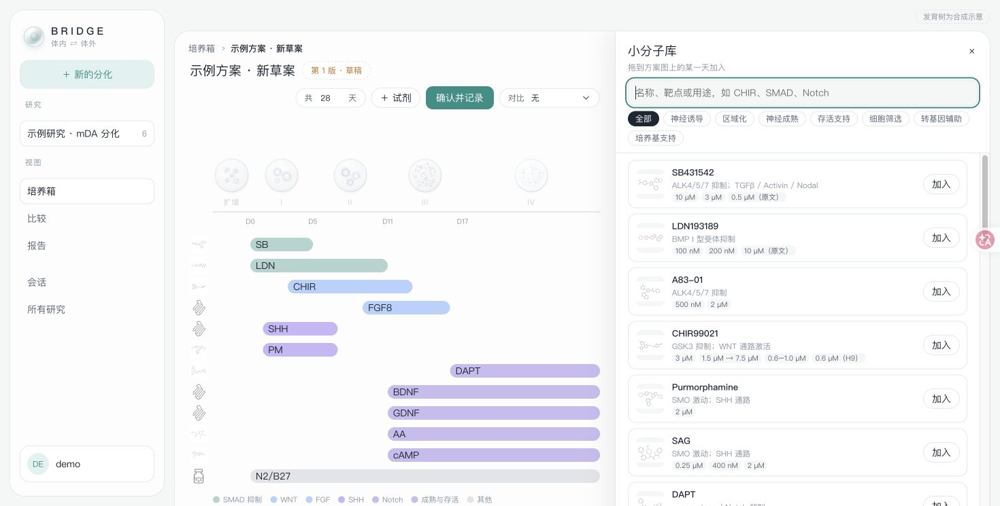
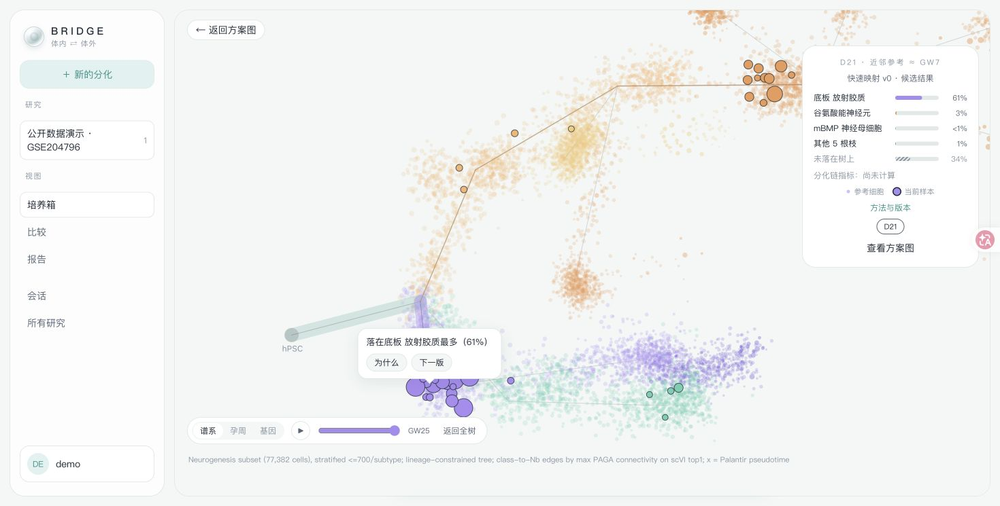
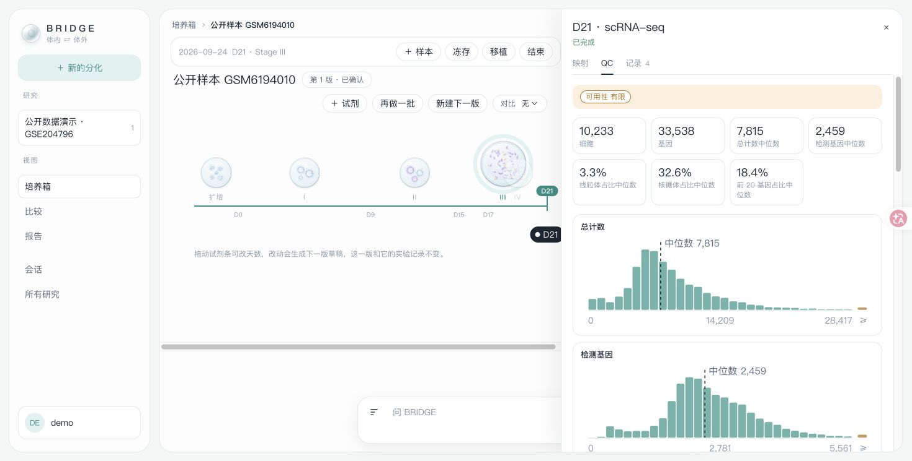

<h1 align="center">BRIDGE</h1>

<p align="center">
  <strong>A research agent for single-cell evidence in cell-therapy products.</strong>
</p>

<p align="center">
  <a href="https://github.com/starvingarc/BRIDGE/actions/workflows/ci.yml"></a>
  <a href="LICENSE"></a>
  <a href="docs/product-principles.md"></a>
</p>

<p align="center">
  <a href="#latest-progress"><strong>Latest progress</strong></a> &nbsp;·&nbsp;
  <a href="#get-started">Get started</a> &nbsp;·&nbsp;
  <a href="examples/demo/README.md">Try the sample data</a> &nbsp;·&nbsp;
  <a href="docs/README.md">Documentation</a> &nbsp;·&nbsp;
  <a href="docs/validation/README.md">Validation</a>
</p>

---

BRIDGE helps researchers explore cell states in cell-therapy products using
single-cell data. The first use case is **hPSC-derived midbrain dopaminergic
products for Parkinson's disease research**.

> [!NOTE]
> **Why I’m Building BRIDGE**
>
> BRIDGE stands for *Brain-Referenced In vivo–to–in vitro Developmental Guidance and Evaluation*. It started with a simple idea—use how cells develop in the body to better understand and improve the cells we grow in the lab. Along the way, I realized there’s a gap between AI and cutting-edge research that we can’t close just by talking or writing more. A lot of scientific know-how lives in the work itself, in everyday experiments, discussions, and decisions. So I’m taking BRIDGE a step further, building it into a sci agent that works alongside researchers and turns those experiences, with their context, evidence, and outcomes, into material for training and evaluating models. The goal is for AI to learn from real research, then bring what it learns back into the lab.

## Latest progress

### Workbench update · 2026-10-15

**Source update.** The workbench implementation, backend services, tests and
setup documentation are included in this repository. Scientific references and
user data are configured separately; the reference assets shown below are not
bundled with the source.

The workbench brings protocols, experiment batches, samples and analysis history
into one research space. The screenshots are actual browser captures in the
**light theme**, using a demo account, illustrative protocols and a public
single-cell sample. [Screenshot sources and scope](docs/assets/progress-2026-10-15/README.md).

**A clearer daily workflow**

The incubator shows differentiation, expansion, frozen and grafted batches,
together with their day, stage and scheduled operations. Login returns to the
recent research space. Confirming a protocol records an experiment; “run another
batch” reuses the same version, while a new draft preserves earlier experiments.

**Edit protocols on the timeline**

- Drag reagent timing, search the molecule library and add reagents to the
  diagram. Dose changes for the same factor share one lane.
- Imported protocols retain source references and fields that need review.
  Original text opens on demand from reagent details or review items.



*An illustrative protocol in the actual editor. Displayed doses and schedules
are demonstration content, not recommended experimental procedures.*

**Explore samples against the reference developmental tree**

- Sampling points open a side panel with **Mapping, QC and Records**. Same-day
  samples can be grouped and switched without leaving the protocol.
- Reference mapping shows where query cells project onto the configured tree;
  stored marker expression can be used to inspect the projection.
- Sample-level UMAP and cell-cycle exploration sit alongside reference mapping.
  These remain descriptive analyses rather than validated cell identities.



*Reference-tree view with public sample
[GSM6194010 (GSE204796)](https://www.ncbi.nlm.nih.gov/geo/query/acc.cgi?acc=GSM6194010).
The projection is a research preview, not independent biological validation.*

**QC and previous results stay with the sample**

- Cell and gene counts, mitochondrial content, doublet candidates and cell-cycle
  views are now collected under QC. Missing inputs and unassessed checks remain
  explicit; missing evidence is not a passing result.
- Records retain earlier analyses and their outputs, so a newer result does not
  silently replace the previous evidence.



*QC of the same public demonstration sample. Candidate calls and unavailable
checks retain their stated limitations.*

**Account and model controls**

The development build adds account-based sign-in and provider/model settings.
Model and thinking-effort selection sit beside the conversation input and apply
to the next question.

**Still in progress:** broader reference coverage, calibrated lineage indicators
and independent biological validation. Atlas projections and QC do not establish
cell function, clinical efficacy, safety or manufacturing release readiness.

## Get started

Run BRIDGE as a **private, self-hosted Web application** with account-based login.
Internal multi-user testing is available through explicit configuration; this
source update does not establish a public hosted service.
The Python package is currently **`0.3.0`**; use the Git commit to identify the
source snapshot. See the [version policy](docs/RELEASE.md#当前开发版本). Requires **Python 3.12** and **Node.js 22.12+**; the supported
versions are maintained in [pyproject.toml](pyproject.toml) (`requires-python`) and
[frontend/package.json](frontend/package.json) (`engines.node`).

### 1. Install and build

```bash
git clone https://github.com/starvingarc/BRIDGE.git
cd BRIDGE

python -m pip install ".[qc,web,evidence,process,target-regional,developmental]"
npm --prefix frontend ci
npm --prefix frontend run build
```

### 2. Configure your private instance

Follow the [setup guide](docs/web-preview.md#start-a-private-instance) to
initialize account storage and configure a model provider and the built frontend. Store credentials in private runtime configuration outside the
repository.

Start the service, then open the address you configured:

```bash
bridge-web --config /absolute/path/web.env
```

### 3. Try the sample data

Try the [synthetic product and reference](examples/demo/README.md), a small
self-contained dataset for development and upload testing.
Synthetic inputs exercise the software and do not validate biological results.

For direct Python or CLI use, see the [tool guide](docs/tool-packages.md) and
[request examples](examples/README.md). Set the example paths and checksums
for your own files before running.

## Explore & contribute

[Documentation](docs/README.md) ·
[Research workflow](docs/assets/bridge-biological-workflow.svg) ·
[Scientific principles](docs/product-principles.md) ·
[Privacy & provenance](docs/privacy-and-provenance.md) ·
[Contributing](CONTRIBUTING.md) ·
[Issues](https://github.com/starvingarc/BRIDGE/issues)

---

<p align="center">
  <sub>Brain-Referenced In vivo-to-in vitro Developmental Guidance and Evaluation</sub><br>
  <sub>Open source under the <a href="LICENSE">MIT License</a>.</sub>
</p>

## Interested in trying BRIDGE?

We plan to offer limited early access after publication of the accompanying paper.
For research inquiries or to express interest in early access, contact the author
at [yxw391588@gmail.com](mailto:yxw391588@gmail.com).
