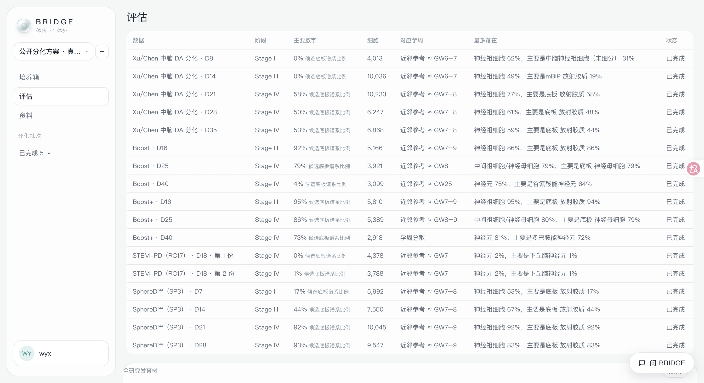
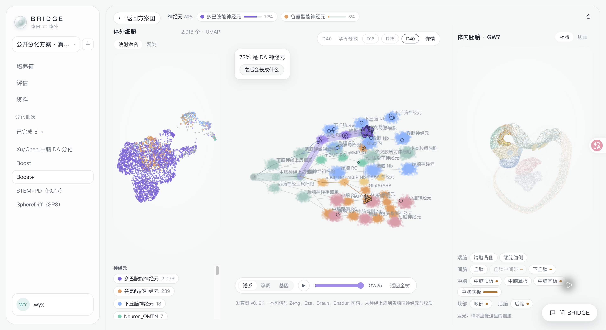
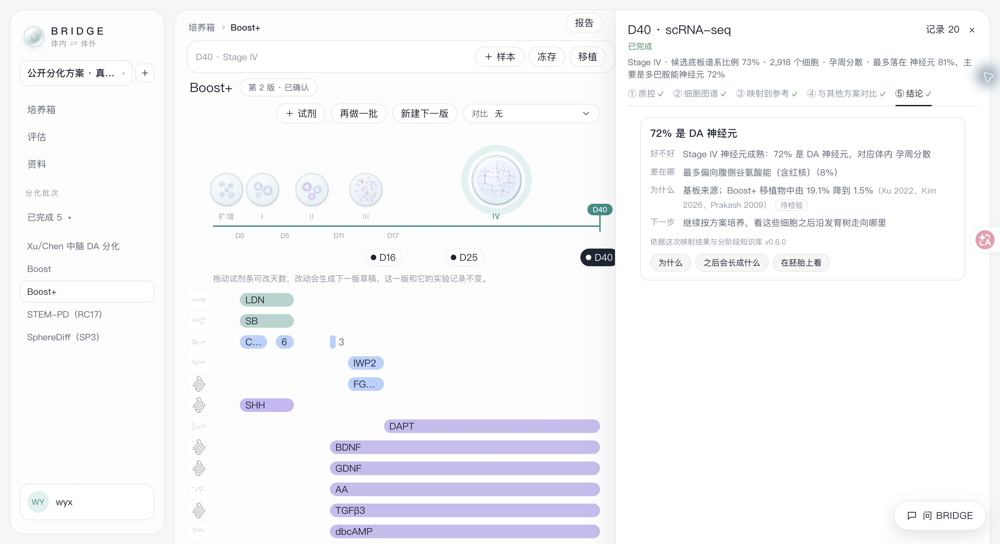
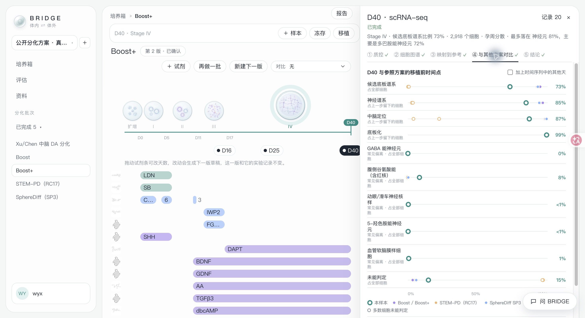
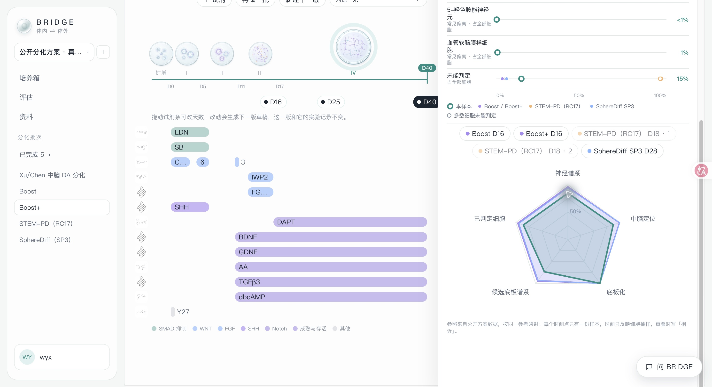

# BRIDGE 更新说明｜2026 年 10 月 21 日

本次更新把样本评估、结果解释和公开方案对比串到了同一条使用路径中。你可以从分化批次打开样本，逐步查看质控、细胞图谱、参考映射、方案对比和结论，再围绕当前结果继续提问。

更新范围：2026 年 10 月 15—21 日。本文保留 10 月 21 日试用版的功能状态与界面实拍，作为历史更新记录，不代表当前版本或本仓库源码已包含全部展示功能。

## 评估流程更集中

主导航整理为「培养箱」「评估」「资料」。培养箱保留分化方案、阶段和取样点；打开样本后，按「质控 → 细胞图谱 → 映射到参考 → 与其他方案对比 → 结论」查看结果，已完成的步骤会显示标记。

查看某一天的样本时，可以保留它在分化方案中的位置，减少在实验背景和分析结果之间来回查找。

## 映射结果更容易看懂

评估界面把体外细胞、发育树和胚胎参考视图放到一起，便于对照细胞分布、参考状态与区域背景。细胞名称先展示大类，再展开亚型，样本图、发育树和图例使用一致的名称。

本轮更新扩大了早期发育与不同脑区的参考覆盖，并重新计算了展示用的 17 个公开样本。区域标记与预测不一致、或证据不足的细胞会保留为「未能判定」，避免给出过于确定的标签。

映射栏新增分化漏斗，帮助查看细胞在神经谱系、中脑定位、底板化等环节的分布，以及非目标与未能判定的部分。

## 结论直接回答四个问题

新版结论按「好不好、差在哪、为什么、下一步」组织，结合样本所处的分化阶段给出摘要，并保留关键数值与依据，方便继续核对。

工作台与对话使用同一份结论。样本数据或参考变化后，会提示重新映射；知识或阶段信息变化时，可以更新结论，减少旧结果与新说明混用。

## 可以与公开方案直接对比

样本映射完成后，可在第 ④ 步打开「与其他方案对比」。当前参照库接入了 13 个公开方案时间点，默认查看移植前时间点，也可以加入时间序列中的其他天。

各项指标以点图展示本样本与参照的位置，展开后能查看数值和区间；新增雷达图，可以选择参照方案与本样本叠加，快速查看各维度的差异。多数细胞未能判定的参照会单独提示。

这些对比用于发现差异与提出问题。当前区间只反映细胞抽样，不能据此认定某个方案整体更好，也不能代替独立实验重复。

## Agent：围绕研究问题先查再答

这次更新也扩展了对话 Agent。围绕当前样本追问时，它可以按问题需要连续查询已有结果、阶段知识与文献，再组织回答。你可以从发育树上的细胞或样本结果继续问，减少手工复制数据和实验背景。

- **结合样本证据解释结果。**可读取细胞组成、未能判定比例、分化漏斗和工作台结论，并查询已有标记基因表达，与参考细胞对照。对话与工作台使用同一份结论，结果过期时保留提示。
- **结合分化过程看变化。**可结合对话已关联的方案步骤、分化阶段，以及同一批次其他取样天的结果，帮助讨论变化出现在哪一段；也可查询研究中已登记的资料和分析状态。
- **查阅阶段知识与文献。**可查询各阶段应关注的指标、已知偏离方向，并检索论文、阅读摘要，在回答下列出查阅依据。当前文献阅读以摘要为主；知识库给出的常见原因仍是需要检验的解释。
- **在对话中比较公开方案。**可读取与界面相同的参照方案库，结合分化漏斗逐项解释本样本与公开时间点的差异，并保留未能判定比例和抽样区间的限制。

可以尝试这样问：「这簇细胞的标记基因支持当前标签吗？」「和上一个取样日相比，主要变化在哪里？」「与公开方案相比，差异主要出现在哪一步？」这些是可使用的提问方式，并非本次逐条重新验收的结果。

**长对话可以保留更多上下文。**会话变长后，系统会将较早内容整理为摘要，尽量保留研究问题、约束与纠正、已讨论的数值和待解决问题，再继续对话。这一能力作用于当前会话，跨会话的长期研究记忆仍待完善。

**工作过程与模型选择更透明。**回答中的工作步骤可以展开查看，了解查过哪些结果与资料；对话输入区可选择模型与思考强度。已配置的共享模型可供试用，复杂问题仍可能等待较久。

本轮新增的查询能力只读取已有结果，不会因一次查询自动修改样本记录或重新计算。针对方案的改进建议仍需结合实验背景核对；中断后的恢复、模型失败提示与重试仍有待完善，具体限制见下一节。

## 仍在完善的部分

- 结论中的改进方向还需要更稳定地对应到具体方案步骤。
- 多方案三维轨迹对比、体外细胞的真实胚脑空间定位，以及向后发育走向的预测与验证尚未完成。
- 模型服务失败后的提示、重试和上下文恢复仍有问题；少数对话可能等待较久，后续简单消息也可能继续处理上一条未完成的问题。

当前参考与映射仍用于研究探索。与某个体内状态接近，不等于已经证明细胞身份、功能或未来命运；三维参考展示也不等于已经完成真实空间定位。

## 版本与截图说明

功能状态已与 10 月 21 日晚间的部署记录、当时的版本代码和可读取的页面信息核对。本次未重新进行完整功能验收。

已补齐 10 月 21 日当前页面实拍：评估总览、三栏联动、新版结论、方案对比和雷达图。截图使用公开方案示例，数值与解释的适用范围以正文说明为准。

截图来源、文件校验与适用范围见[图片说明](../assets/progress-2026-10-21/README.md)。
